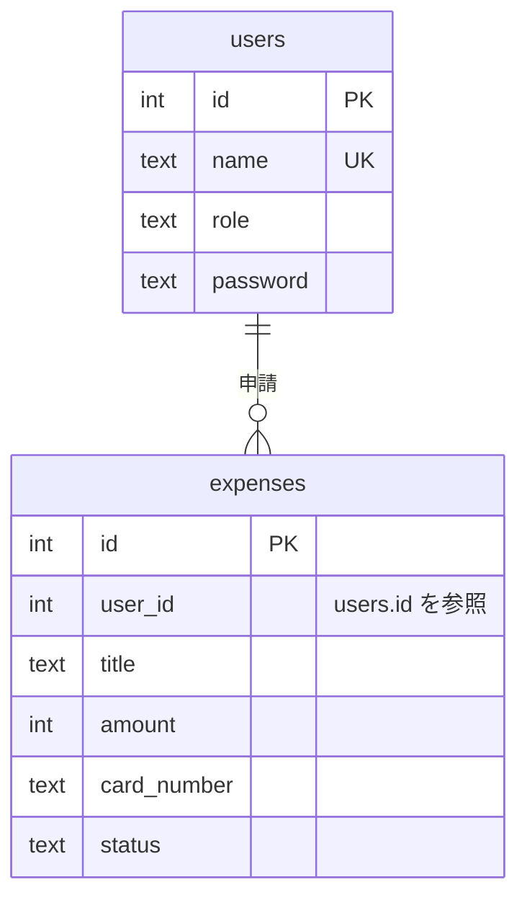

# rust-secreview-ollama

[](https://github.com/mismd2026/rust-secreview-ollama/actions/workflows/security.yml)

**何を**：Rust（actix-web＋diesel）で作った経費精算APIに脆弱性を12種仕込み、SAST・SCA・秘密情報・コンテナ設定の検査をCI/CDに組み込んで、どこまで自動で見つけられるかを検証しています。
**なぜ**：決まった検査はツールに任せ、ツールでは見つけにくいロジックの問題（認可漏れなど）はローカルLLM（Ollama）に候補を出させる、という役割分担を数字で確かめるためです。
**結果（段階1）**：ツール担当の8種はすべて検出し、正解表にない指摘（誤検知の候補）は0件でした。ロジックの4種はツールでは検出できず、段階2でLLMが担当します。

> [!WARNING]
> このアプリは**意図的に脆弱**です。検証用であり、本番環境や公開ネットワークで動かさないでください。サーバーは `127.0.0.1` にだけ待ち受けます。ソース中の秘密鍵はダミーです。

## 構成

```
push / PR
 └─ GitHub Actions（.github/workflows/security.yml）
     └─ scripts/run_local.sh（手元でも同じものを実行できる）
         ├─ clippy        unsafe まわりの lint を有効化     → SARIF（clippy-sarif）
         ├─ cargo audit   依存crateの既知の脆弱性（RustSec） → SARIF（scripts/audit_to_sarif.py で変換）
         ├─ cargo deny    脆弱性・ライセンス・取得元のポリシー
         ├─ Semgrep       自作ルール（.semgrep/rust-security.yml） → SARIF
         ├─ gitleaks      秘密情報（標準ルール＋自作ルール） → SARIF
         └─ Checkov       Dockerfile の設定 → SARIF
             ↓
         scripts/summarize.py が SARIF を正解表（eval/ground_truth.yaml）と照合
             ↓
         Job summary に結果表、Code scanning に各指摘
```

ソースコードには脆弱性のヒントになるコメントを書いていません。答え合わせは正解表だけで行います。

## 仕込んだ脆弱性と検出結果（段階1：ツールのみ）

| ID | 脆弱性 | CWE | 想定 | 検出したツール |
|---|---|---|---|---|
| V1 | 他人の経費を番号の書き換えで閲覧できる（IDOR） | CWE-639 | LLM | - |
| V2 | 一般社員が経費を承認できる（権限チェック漏れ） | CWE-285 | LLM | - |
| V3 | 検索でSQLインジェクションが起きる | CWE-89 | ツール・LLM | Semgrep |
| V4 | JWTの署名を検証していない | CWE-347 | ツール・LLM | Semgrep |
| V5 | JWTの秘密鍵がソースに埋め込まれている | CWE-798 | ツール | Semgrep, gitleaks |
| V6 | 境界チェックなしの unsafe で未定義動作になる | CWE-125 | ツール・LLM | Semgrep, clippy |
| V7 | CORSを全許可している | CWE-942 | ツール・LLM | Semgrep |
| V8 | ログにパスワードとカード番号が出力される | CWE-532 | ツール・LLM | Semgrep |
| V9 | 既知の脆弱性がある依存crate（tar 0.4.35） | CWE-1395 | ツール | cargo-audit |
| V10 | コンテナが root で動く | CWE-250 | ツール | Checkov |
| V11 | パスワードを平文で保存・照合している | CWE-256 | LLM | - |
| V12 | カード番号を全桁のまま保存し、APIでも全桁を返している | CWE-359 | LLM | - |

### 仕込んでいないが見つかった実在の指摘（2026-11-12時点）

| ID | 内容 | 判断 |
|---|---|---|
| U1 | h2 0.3.27（RUSTSEC-2026-0258） | 上流待ち：actix-web 4 系が h2 0.3 に依存しているため、こちらでは上げられない |
| U2 | libsqlite3-sys 0.38.2（RUSTSEC-2026-0459） | 上流待ち：修正版は 0.39 以上だが、diesel 2.3.14 が 0.38 までしか受け付けない |
| U3 | HEALTHCHECK がない（CKV_DOCKER_2） | 受容：検証用アプリのため対応しない |

RustSec のデータベースは日々更新されるので、件数は実行日によって変わります。

### 検証して分かったこと

- **gitleaks は標準ルールだけでは、Rust の定数に埋め込んだ鍵を見逃しました。** `const JWT_SECRET: &str = "..."` の形に合う自作ルールを `.gitleaks.toml` に追加して検出できるようにしています。
- **Semgrep の公開ルールに頼らず、自作ルールを6本書いています。** diesel の `sql_query` に `format!` の結果を渡す形など、このスタックに特有の書き方を対象にしています。
- **cargo audit の結果は SARIF を出さない**ので、変換スクリプトを用意して他のツールと同じ形にそろえました。

## 再現手順（ローカルのみ）

```bash
cargo run    # 127.0.0.1:8080 で起動。expense.db を自動作成し、alice / bob / carol を登録する

B=http://127.0.0.1:8080
T=$(curl -s -XPOST $B/login -H 'Content-Type: application/json' \
      -d '{"name":"alice","password":"alice-pass"}' | jq -r .token)

# V1：alice のトークンで bob の経費（id=3）が読める
curl -s $B/expenses/3 -H "Authorization: Bearer $T"

# V3：検索語にSQLを混ぜると全員分が返る
curl -s -G $B/search --data-urlencode "q=' OR 1=1 --" -H "Authorization: Bearer $T"

# V2：一般社員の alice が承認できる
curl -s -XPOST $B/expenses/3/approve -H "Authorization: Bearer $T"
```

V4（署名なしの偽トークン）は、ヘッダーとペイロードを Base64URL にして、署名部分を適当な文字列にしたトークンで `/expenses` を呼ぶと、ペイロードの `sub` のユーザーとして通ります。

## 検査を手元で実行する

```bash
# 必要なもの：cargo-audit, cargo-deny, clippy-sarif, semgrep, gitleaks, checkov, python3 + pyyaml
cargo install cargo-audit cargo-deny clippy-sarif --locked
pip install semgrep checkov pyyaml
./scripts/run_local.sh     # reports/summary.md に結果表ができる
```

## 今後（段階2・3）

- **段階2**：SARIF とコードの前後を読み込み、Ollama（ローカルLLM）と RAG（OWASP ASVS・CWE・RustSec）で、優先度付け・誤検知の判定・修正案を付けた診断報告書を出す。ルーティングと認可の処理を読ませて、V1・V2 のようなロジックの問題の候補も出す。コードを外部に送らない構成にする。
- **段階3**：ツールのみ／ツール＋LLM／LLMのみ で検出率と誤検知を比べた表を作り、LLMに任せられる範囲と人が見るべき範囲を示す。

## データベース

SQLite を diesel 経由で使います（`src/db.rs`、起動時にテーブルを作成）。



## ファイル

| パス | 内容 |
|---|---|
| `src/` | 検証用の経費精算API（actix-web＋diesel＋SQLite） |
| `eval/ground_truth.yaml` | 正解表（仕込んだ脆弱性・正しく実装した箇所・実在の指摘） |
| `.semgrep/rust-security.yml` | Semgrep の自作ルール |
| `.gitleaks.toml` | gitleaks の設定（自作ルール・対象外パス） |
| `deny.toml` | cargo deny のポリシー |
| `scripts/` | 実行スクリプト、cargo audit の SARIF 変換、正解表との照合 |
| `.github/workflows/security.yml` | CI |

---

**English summary**: An intentionally vulnerable Rust (actix-web + diesel) expense API with 12 planted vulnerabilities, used to measure how far SAST/SCA/secret/container scanners in CI can go. Stage 1: all 8 tool-detectable issues found with zero unmatched findings; the 4 logic flaws (IDOR, missing authorization, plaintext storage) are left for a local-LLM (Ollama + RAG) review in Stage 2. Do not deploy.

## License

MIT
